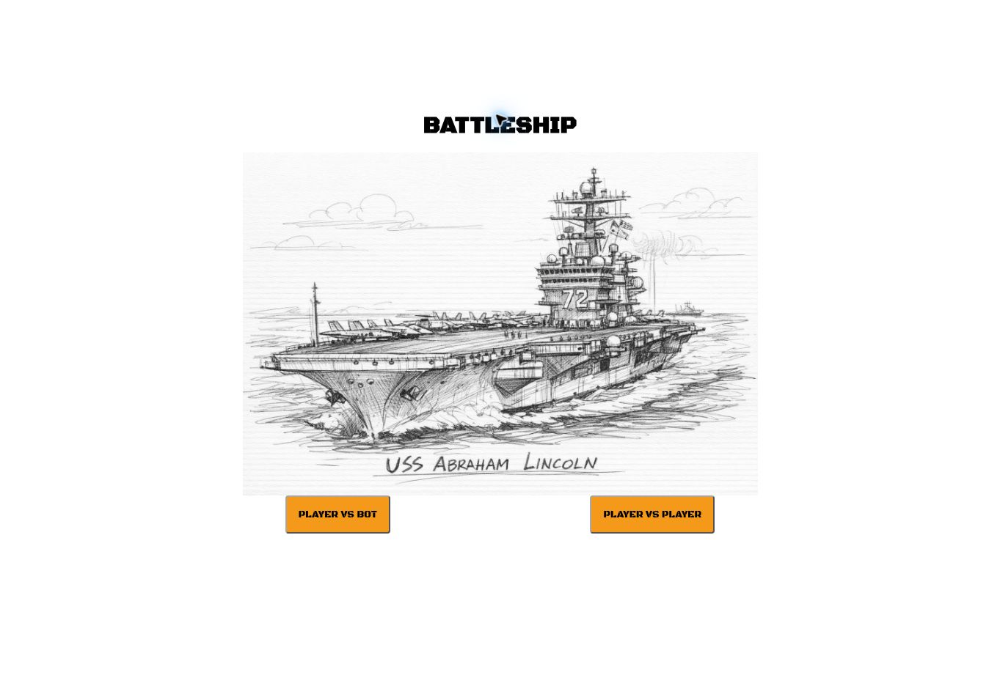
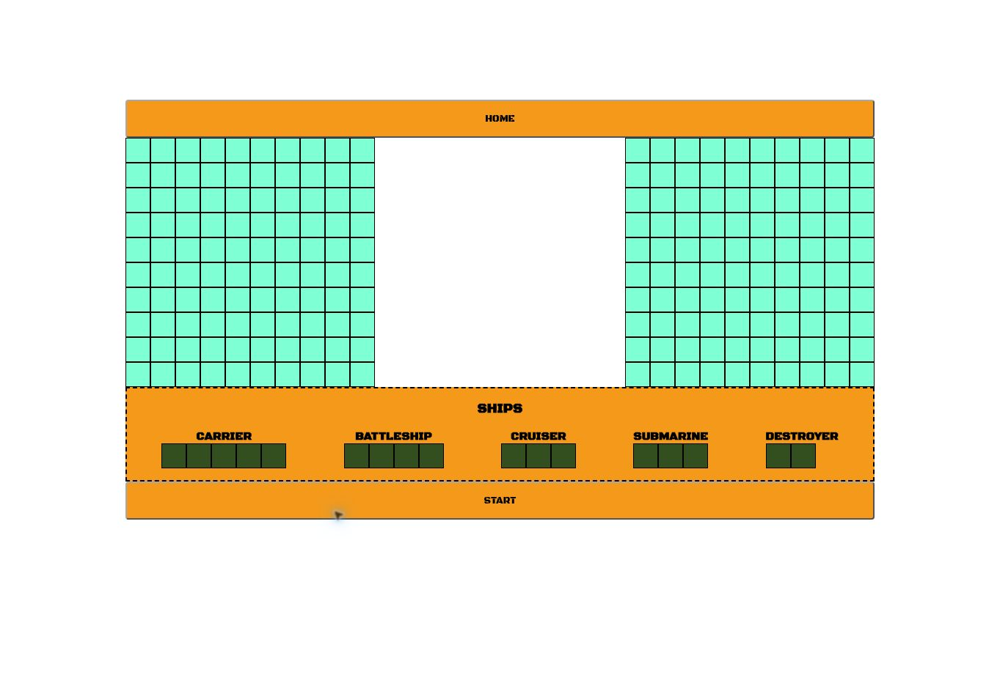

# Battleship

A browser implementation of Battleship built with vanilla JavaScript. Arrange a fleet on a 10 × 10 board, start a match against a computer opponent, and attack its hidden ships using the second grid.

**[Play the live demo](https://pourixa.github.io/battleship/)**



## Gameplay

1. Choose **PLAYER VS BOT**.
2. Drag the five ships onto the left board. Placement is horizontal; ships must fit within a row and must not overlap.
3. Once all ships are placed, use **RESET** to rearrange them or **START** to begin.
4. Click cells on the right board to attack. The computer responds after each valid attack.
5. Sink the opposing fleet to win. Hit/miss feedback and sunk-ship messages appear during the match.

The fleet contains a carrier (5 cells), battleship (4), cruiser (3), submarine (3), and destroyer (2).



**PLAYER VS PLAYER is currently a placeholder.** The implemented mode is player versus bot. A desktop browser with a mouse is the intended way to use the drag-and-drop controls.

## Implementation

The board stores references to ship objects, allowing attacks on different occupied cells to update the same ship's hit count. The ship tracks whether it has sunk; the board tracks the fleet and the overall end condition.

The computer creates a random fleet and chooses random unattacked cells. This is a rule-based opponent, not a machine-learning model.

| Module | Responsibility |
| --- | --- |
| `scripts/ship.js` | Ship length, hit count, and sunk state |
| `scripts/gameboard.js` | Board cells, ship placement, attacks, and game-over checks |
| `scripts/player.js` | Human attacks, random bot placement/attacks, and feedback |
| `scripts/dragAndDrop.js` | Placement previews and drag-and-drop handling |
| `scripts/elements.js` | Creates board and fleet interface elements |
| `scripts/gamelogic.js` | Connects the player and computer during a match |
| `src/script.js` | Menu flow, board setup, and starting a game |

## Tech stack

JavaScript, HTML, CSS, Webpack, Babel, and Jest. No backend, database, or environment variables are required.

## Run locally

Use Node.js and npm; the build was checked with Node.js 24.

```bash
git clone https://github.com/Pourixa/battleship.git
cd battleship
npm ci
npm run dev
```

Open the URL printed by Webpack's development server.

```bash
npm run build
npm test -- --runInBand
```

The build writes to `dist/`. The existing `deploy` script publishes that directory to the repository's `gh-pages` branch and is only needed when intentionally deploying.

## Current status

- The production build passes. The deployed menu and fleet-placement screen were inspected for the screenshots; a complete match was not verified in that check.
- The Jest suite currently fails before running tests: `gameboard.test.js` calls an outdated placement signature during setup, and `ship.test.js` contains no tests. The skipped board cases also need to be brought in line with the current model.
- Fleet rotation and player-versus-player gameplay are not implemented.
- The bot's placement bounds currently exclude some edge positions; broader placement coverage is a future improvement.

The screenshots are captures of the deployed application, not mockups.
